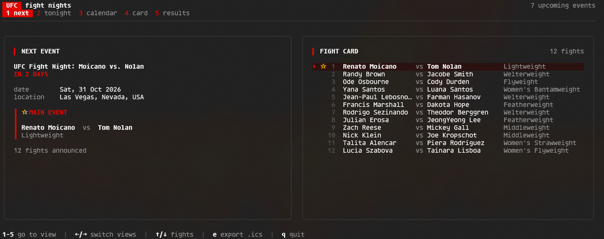
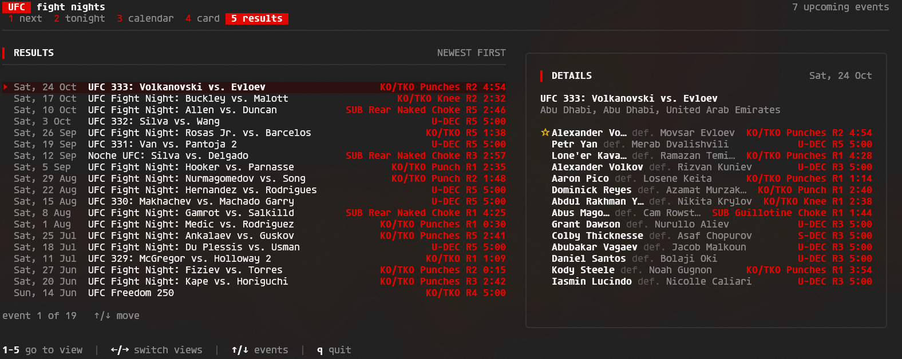

# UFC TUI

A terminal UI for browsing upcoming UFC events and recent results. No account, database, or API key required: the scraper fetches event data and saves it as JSON, and the app reads that local cache.

## Next Event


## Results


## Features

- **Next** — see the next event's date, location, and main event.
- **Tonight** — check whether an event is scheduled for today, or see when the next one takes place.
- **Calendar** — browse upcoming events grouped by month, with fight-card counts.
- **Fight card** — browse the next event's bouts, with the main event highlighted.
- **Results** — review up to 20 completed events, newest first, with the main-event outcome.
- **Calendar export** — export the next event as an all-day `.ics` file.
- **Local cache** — browse saved event data without an account or API key.

## Keyboard shortcuts

| Key | Action |
|---|---|
| `1` … `5` | Jump to a view. |
| `←` `→` | Switch views. Also `h` / `l` and `tab` / `shift+tab`. |
| `↑` `↓` | Move through fights or events. Also `k` / `j`. |
| `e` | Export the next event to `.ics` (Next, Tonight, and Fight card views). |
| `g` `G` | Jump to the top or bottom of a list. Also `home` / `end`. |
| `q` | Quit. Also `ctrl+c` and `esc`. |

## Export to a calendar

```sh
ufc export            # save to a filename based on the event
ufc export -o -       # write the .ics file to stdout
ufc export -o my.ics  # choose an output filename
```

The export includes the next event as an **all-day** calendar entry. Event titles, locations, and fighter names remain as provided by UFCStats; generated descriptions are in English.

## Install

Requires Go 1.27 or later.

```sh
go install github.com/offluisangel/UFC/cmd/ufc@latest
ufc tui
```

Go installs the executable to `GOBIN`, or to `GOPATH/bin` if `GOBIN` is not set. Make sure that directory is on your `PATH`. On Windows, the executable is named `ufc.exe`. Run `go install` again to update.

The app stores its cache at `data/events.json`, relative to the directory from which you run it. To sync event data manually:

```sh
ufc-sync
```

On Windows, download and extract the ZIP release, then run `ufc.exe tui` from that folder or a terminal opened there.

## Development

Tests use saved HTML fixtures and do not require network access.

```sh
go test ./...
go test ./... -v
go vet ./...
gofmt -l .
```

## How it works

```
ufcstats.com
     │  HTTP + proof-of-work challenge
     ▼
internal/fetch ──► data/events.json
     │                 │
     │                 ▼
     └──────────► internal/dataset ──► internal/ui
```

| Package | Responsibility |
|---|---|
| `cmd/ufc` | TUI entry point; decides whether to sync and starts Bubble Tea. |
| `cmd/ufc-sync` | Manual sync entry point. |
| `internal/fetch` | HTTP client, proof-of-work challenge, HTML parsing, deduplication, and JSON writing. |
| `internal/dataset` | Queries over the loaded JSON: upcoming events, fight cards, and results. |
| `internal/ui` | Bubble Tea model, views, and styles. |
| `internal/model` | `Fight`, `Event`, `Dataset`, and date parsing. |

Built with [Bubble Tea](https://github.com/charmbracelet/bubbletea), [Lip Gloss](https://github.com/charmbracelet/lipgloss), and [goquery](https://github.com/PuerkitoBio/goquery).
