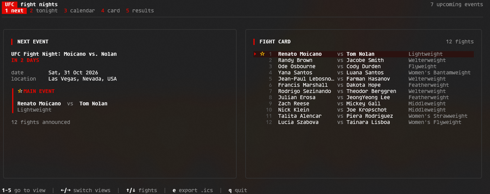
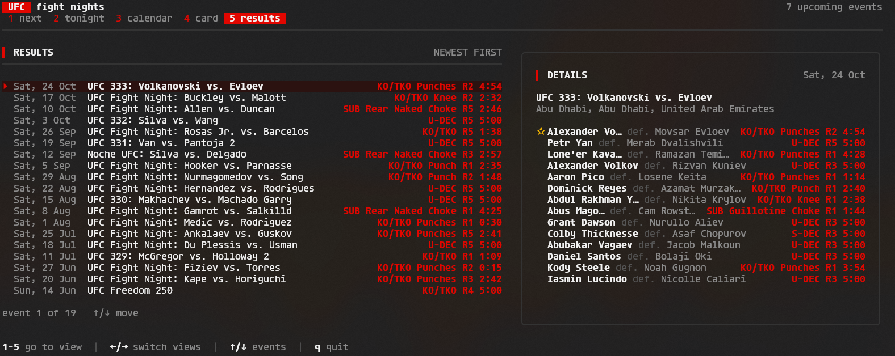

# UFC TUI

Browse upcoming UFC events, fight cards, and recent results from your terminal.

## Next Event


## Results


## Install

These commands require a [release](https://github.com/offluisangel/UFC/releases) containing the installers. No Go installation is needed.

### Linux / Omarchy

Download and inspect the installer, then install to `/usr/local/bin`:

```sh
curl -fLO https://github.com/offluisangel/UFC/releases/latest/download/install.sh
less install.sh
sudo sh install.sh --system
```

### Windows (PowerShell)

```powershell
Invoke-WebRequest https://github.com/offluisangel/UFC/releases/latest/download/install.ps1 -OutFile install.ps1
Get-Content .\install.ps1
.\install.ps1 -AddToPath
```

## Use

From any directory:

```sh
ufc tui
```

Internet access is needed to fetch fresh event data; saved data can be browsed offline.

| Key | Action |
|---|---|
| `1` … `5` | Jump to a view. |
| `←` / `→` | Switch views. |
| `↑` / `↓` | Move through fights or events. |
| `e` | Export the next event to your calendar. |
| `q` | Quit. |

To export without opening the TUI:

```sh
ufc export
ufc export -o my.ics
```
